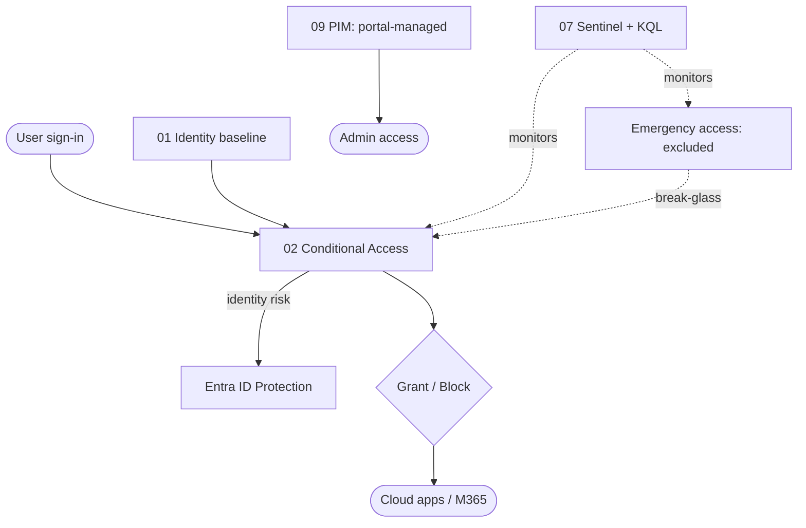

# Azure Entra Zero Trust Landing Zone

[](https://developer.hashicorp.com/terraform)  [](LICENSE)  

A **Terraform-driven** Zero Trust identity baseline for Microsoft Entra ID, built and tested in a lab tenant. Four Conditional Access policies are rendered from one reusable module. Two emergency accounts use portal-managed passkeys and belong to two code-defined exclusion groups. Two Sentinel rules monitor the emergency path; the third is a tenant-wide password-spray indicator. The accounts, groups, policies and detections are defined as code; passkeys and PIM are portal-managed. See the [control evidence index](docs/screenshots.md#control-evidence-index).

Start with the evidence: [What If results, test sign-ins, Sentinel alerts and ingestion measurements](docs/screenshots.md), and the [decision records](docs/adr/) behind each trade-off.

> **Status: archived lab.** The configuration and tests document the historical licensed lab window. The owner reports that the trial licences have expired; no expiry date is asserted. Current tenant operation and premium-control operation are unverified, and licence expiry does not establish decommissioning. Device management (Intune, Autopilot, update rings, Defender for Endpoint) is out of scope; see [Scope boundary](#scope-boundary). PIM is **Portal-managed and evidenced** for a test administrator, with the limits documented [below](#known-limitations).

## Why this exists

Most identity work is invisible — a policy clicked in a portal leaves no artifact. This repo makes the *design thinking* visible: controls are codified, trade-offs are written down, scope decisions are justified rather than quietly dropped, and every status word is chosen to mean exactly one thing. It's the bridge between administering Entra and architecting identity security.

## Architecture at a glance



Device-management controls are not shown; they are out of scope for this release.

### Control status

Statuses below describe the historical lab evidence, not verified current operation. They are used with fixed meanings: **Planned** (design only), **Code-defined** (configuration exists, no verified deployment), **Deployed** (object exists in the lab), **Report-only evaluated** (evaluated without enforcement), **Enabled and tested** (enforced, with a safe test and evidence record), **Enabled; What If tested** (enforced, and tested with Conditional Access What If rather than a live triggering event), **Portal-managed and evidenced** (implemented manually, with configuration and operational proof). "Complete" is deliberately not a status.

| # | Module | Purpose | Zero Trust pillar | Status |
|---|--------|---------|-------------------|--------|
| 01 | identity-baseline | Accounts, groups and manual tenant settings | Identity | Accounts/groups: code-defined; emergency access: Enabled and tested; manual tenant settings: no public evidence |
| 02 | conditional-access | CA policy framework as reusable Terraform | Identity | Enabled and tested (CA001, CA003: What If tested; CA004: Report-only evaluated) |
| 07 | sentinel-kql | Sentinel workspace, Entra log export, KQL detections as code | Detection | Deployed; see [detection detail](#sentinel-detections-module-07) |
| 09 | administrative-governance | Emergency access and test-admin PIM | Identity / Governance | Emergency access: Enabled and tested; PIM: Portal-managed and evidenced |
| 08 | cloud-lifecycle-automation | Cloud-only joiner/mover/leaver automation | Automation | Planned — not implemented; see [Linked work](#linked-work) |

### Scope boundary

Modules 03–06 are **out of scope for v1.0**. This is a decision, not a backlog item.

| # | Module | Reason |
|---|--------|--------|
| 03 | device-compliance | Intune configuration lives in Microsoft Graph, while AzAPI targets Azure Resource Manager — the originally planned provider approach was structurally impossible |
| 04 | autopilot | Same provider boundary |
| 05 | update-rings | Same provider boundary |
| 06 | defender-endpoint | Same provider boundary; also depends on 03 |

Three Terraform providers were evaluated as alternatives (`microsoft/msgraph` public preview, `deploymenttheory/microsoft365`, `terraprovider/microsoft365wp`). None was adopted for this release. The directories are retained with their design notes: a documented scope boundary is evidence of a decision, whereas a deleted directory is evidence of nothing. The reasoning, the rejected alternatives, and what would change the assessment are recorded in [ADR-006](docs/adr/adr-006-device-management-out-of-scope.md).

### Conditional Access policy set (module 02)

| ID | Policy | State |
|---|---|---|
| CA001 | Block legacy authentication | Enabled; What If tested |
| CA002 | Require MFA for all users, emergency accounts excluded | Enabled and tested |
| CA003 | Block high-risk sign-ins (Entra ID Protection / P2) | Enabled; What If tested |
| CA004 | Remediate high user risk with MFA + secure password change | Report-only evaluated |

All four policies are rendered from a single reusable Terraform module and exclude the dedicated emergency-access groups. The code includes both the legacy and role-assignable groups in every policy's exclusion path; the [Session 2 images](docs/screenshots.md#session-2-emergency-exclusion-evidence) show the group properties, memberships and an emergency-account exclusion evaluation. Current operation is unverified.

**CA004 is deployed in report-only mode** and evaluated with Conditional Access What If for a high-user-risk scenario: it *would* require MFA and a secure password change. No genuine high-risk sign-in occurred in this lab tenant, so no report-only enforcement telemetry exists, and none was manufactured. Report-only means evaluated, not enforced — it neither blocks nor remediates. Promotion to enforced is **not** planned for this release.

### Sentinel detections (module 07)

A Log Analytics workspace with Microsoft Sentinel, a tenant-scoped Entra diagnostic setting exporting sign-in and audit logs, and three scheduled analytics rules — all defined in Terraform, in a separate root with its own state.

| Detection | Status |
|---|---|
| Emergency account sign-in | Enabled and tested — fired on a real emergency-account sign-in |
| Protected exclusion group membership changed | Enabled and tested — canary test on 15 Aug 2026; later 16 Aug alert on an add-member event is consistent with the role-assignable exclusion group (target ID truncated) |
| Password-spray indicator | Deployed and query-validated; no positive event generated, and none simulated |

These are **lab baselines, not production detections**: no entity mapping, no allowlists, no assigned owner, no response procedure. In [the rule code](terraform/detections/rules.tf), membership monitoring runs every 5 minutes over a 15-minute lookback, so it can raise duplicate alerts; this is an accepted trade-off. The emergency-account rule uses 5/5 minutes and the spray rule 10/10, with no extra ingestion-delay allowance. The spray rule counts every non-zero `ResultType`, including MFA interrupts such as 50074 and the 50140 “Keep me signed in” interrupt ([Microsoft error-code reference](https://learn.microsoft.com/en-us/entra/identity-platform/reference-error-codes)); it has no positive-event test. [Measured ingestion](docs/screenshots.md#sentinel-detections-e13): SigninLogs averaged 1.5 minutes (max 2); AuditLogs averaged 3.4 minutes (max 7).

### Emergency access

Two standing Global Administrator accounts, excluded from all four Conditional Access policies, with passkey authentication and Sentinel alerting on their interactive sign-ins.

A **role-assignable parallel exclusion group** is code-defined, with historical deployment evidence for dual exclusions and Sentinel membership monitoring. The [Session 2 captures](docs/screenshots.md#session-2-emergency-exclusion-evidence) show its properties, both groups' memberships and an emergency-account exclusion evaluation. The 16 Aug 2026 19:42 “Add member to group” alert has a `Group.ObjectID` newValue beginning `7c`, consistent with `CA-BreakGlass-Exclude-RoleAssignable` (`7c149300-…`); the truncated ID does not verify the exact target. This is separate from the 15 Aug canary test. The group was added alongside the legacy group rather than replacing it; [the code](terraform/break-glass.tf) retains both groups. Legacy retirement remains out of scope for this close-out.

The exclusions apply to **this repository's** Conditional Access policies. They do not bypass Microsoft's mandatory portal MFA, and the emergency accounts still authenticate with their passkeys.

## Linked work

The adjacent [manage-user-loa](https://github.com/Dhanzz1/manage-user-loa) repository is a PowerShell module for **hybrid Active Directory and Exchange leave-of-absence automation**, exposing `Start-UserLOA` and `End-UserLOA`. It disables and restores the account, moves the user in and out of a leave OU, hides and restores GAL visibility, delegates manager mailbox access, and applies out-of-office behaviour.

That is related identity-lifecycle work, but it is **not** an implementation of module 08. The cloud-only joiner/mover/leaver workflow that module 08 sketches is not implemented in either repository. Adjacent work and delivered scope are different claims, and blending them would misrepresent both.

## Repository structure

```
.
├── terraform/                  # identity run-root — Entra ID and Conditional Access
│   ├── providers.tf  versions.tf  variables.tf  backend.tf
│   ├── break-glass.tf  identity-baseline.tf  conditional-access.tf
│   ├── modules/conditional-access-policy/    # reusable CA policy module
│   └── detections/             # separate run-root — Sentinel workspace and analytics rules
├── 01-identity-baseline/ … 09-administrative-governance/   # per-area design docs
├── docs/                       # architecture, threat model, ADRs, screenshots
└── README.md
```

> Runnable Terraform lives only in `terraform/` and `terraform/detections/`. These are **two separate roots with separate state** — the identity root uses the `azuread` provider, the detections root uses `azurerm`. The numbered folders are the design map for each area.

## Deploy it yourself

> **This is a lab bootstrap sequence, not a production installer.** It is written for a disposable
> tenant you are willing to lose. Do not run it against a tenant anyone depends on.

**Prerequisites:** Terraform ≥ 1.7, Azure CLI, a disposable Entra tenant, and Entra ID P2 (for risk-based Conditional Access and PIM). The detections root additionally requires an Azure subscription for the Log Analytics workspace and Sentinel.

**Why this is staged.** A single `terraform apply` of the identity root would create the emergency
accounts and enable Conditional Access in the same operation. Terraform has no dependency edge
between the Global Administrator assignment and the policy modules, and the emergency accounts'
passkeys are registered in the portal, not in code — so that apply can begin enforcing MFA on every
user in the tenant at a moment when no emergency account can yet satisfy Microsoft's mandatory portal
MFA. Being excluded from a Conditional Access policy is not a recovery path if the account cannot sign
in. The stages below exist to make the recovery path real *before* enforcement starts.

Every stage plans to a file and applies that file. Several of these applies modify live Conditional
Access exclusions, where "the plan I reviewed is the plan that ran" stops being a formality.

```bash
az login --tenant <your-tenant-id>
cd terraform
terraform init
```

### Stage 1 — emergency access first, nothing else

`-target` is used deliberately here. HashiCorp documents it as an exceptional-case tool, and
bootstrapping a recovery path before the controls that could lock you out is the exception.

```bash
terraform plan -out stage1.tfplan \
  -target=azuread_directory_role_assignment.break_glass_global_administrator \
  -target=azuread_group.break_glass_exclude \
  -target=azuread_group.break_glass_exclude_role_assignable
terraform apply stage1.tfplan
```

Terraform pulls the two accounts and their generated passwords in as dependencies. No Conditional
Access policy is created by this stage.

**Gate — verify in the Entra admin center before continuing:**

- both accounts exist and are enabled;
- **both** exclusion groups exist and **each contains both accounts**;
- both accounts hold **active** Global Administrator, not eligible.

### Stage 2 — register and test a passkey on each account, in the portal

Register a **separate** passkey per account. Then, in a private browser window per account, sign in as
each one independently and confirm it reaches the Entra admin center with Global Administrator.

**Gate — do not continue until both accounts have independently signed in and reached the admin
center.** This is the stage the one-shot sequence skipped. An emergency account that has never
completed a sign-in is an untested control.

### Stage 3 — confirm your own account can survive enforcement

Confirm the account you are deploying with is registered for MFA. CA002 targets all users, and you are
not excluded.

### Stage 4 — disable Security Defaults

Entra admin center → **Properties** → **Manage security defaults** → Disabled. This lab configured the toggle manually under its pinned
`hashicorp/azuread ~> 2.50` provider.

The tenant is least protected between this stage and the next. Do not leave it here.

### Stage 5 — Conditional Access

```bash
terraform plan -out stage5.tfplan
terraform apply stage5.tfplan
```

Read the plan. This apply enables CA001–CA003 and creates CA004 in report-only.

**Gate — verify after applying:** open each of the four policies and confirm **both** exclusion groups
appear under Users → Exclude. Then use **Conditional Access What If** for an emergency account and
confirm no policy applies to it.

### Stage 6 — detections root (separate state)

```bash
cd detections
terraform init && terraform plan -out tfplan && terraform apply tfplan
```

### Recovery

If you lose access, sign in with an emergency account — which is why stage 2 exists — and either set
the offending policy to Off in the portal or `terraform destroy -target` the module that created it.
Fix the policy in configuration afterwards; a portal fix that does not exist in code has an expiry
date attached to it.

The emergency-access design and its trade-offs are in [ADR-002](docs/adr/adr-002-break-glass-exclusion.md).

## Known limitations

- **Terraform state is local**, one state file per root, with no remote backend or locking. A lab limitation, not a recommended pattern.
- **PIM is Portal-managed and evidenced**, not code-defined. [v1-02 through v1-07](docs/screenshots.md#privileged-identity-management) show Conditional Access Administrator for `admin_test@dhanzlabs.com`: activation settings, eligibility, justification, an active assignment with expiry, a successful activation audit and later absence from the filtered active list. MFA on activation is configured; a challenge is not captured. The later list does not prove post-expiry access denial. These are historical observations, not evidence of current premium-control operation.
- **Provider versions:** `hashicorp/azuread ~> 2.50` (v2.53.1 in use). The v3 line has not been adopted.
- **CA005 and CA006 are not implemented** — not planned for this release.
- Fuller detail, including the reference tenant profile every trade-off is sized against, is in [assumptions & limitations](docs/assumptions-limitations.md).

## Design docs

- [Architecture](docs/architecture.md)
- [Threat model](docs/threat-model.md)
- [Assumptions & limitations](docs/assumptions-limitations.md)
- [Architectural Decision Records](docs/adr/)
- [Evidence / screenshots](docs/screenshots.md)

## Security & sanitisation

This repository contains **no secrets or Terraform state**. State, `*.tfvars`, plan files and provider schema are gitignored. Published images have no visible tenant ID, subscription ID, source IP or credential identifier. Lab `dhanzlabs.com` UPNs, user/group object IDs and the NordPass name are deliberately visible; these are distinguished from credentials and redacted credential identifiers.

## License

MIT — see [LICENSE](LICENSE).
